# Cryptrace — how the complete system works

> **An encrypted document workspace with observable, real cryptographic operations.**
>
> This guide describes the implementation in this repository. It follows the actual request handlers, cryptographic calls, database records, and browser components. Example calculations are explicitly identified; screenshots are captured from the running application. No credentials or secret keys are included.

**Reading map:** [Architecture](#2-system-architecture) → [Accounts](#5-account-registration-and-email-verification) → [Login](#6-login-and-password-verification) → [Sessions](#8-access-tokens-refresh-rotation-and-logout) → [Encryption](#10-document-upload-and-hybrid-encryption) → [Live visualization](#15-how-the-live-visualization-works) → [Deployment](#19-docker-and-startup) → [Full forms](#24-full-forms-and-terminology).

Mermaid code blocks render as diagrams in GitHub and Mermaid-enabled Markdown viewers. The screenshots remain viewable in ordinary Markdown viewers. In the formulas, `||` means concatenate bytes, `⊕` means bitwise exclusive OR, and `K` denotes a secret key.

---

## 1. What Cryptrace provides

Cryptrace combines account security, encrypted file storage, integrity verification, an authenticated activity history, and a live explanation of the backend work behind each action.

| User action | What actually happens |
| --- | --- |
| Create an account | Validate input, create a salted password verifier, save an unverified account, issue a verification credential, and schedule a real email. |
| Verify email | Hash the supplied credential, locate an unused unexpired matching record, consume it, and mark the account verified. |
| Sign in | Check account policy, run bcrypt password verification, and either create a session or require an email code. |
| Enable a second factor | Persist a policy requiring a six-digit email code on subsequent logins. |
| Refresh a session | Revoke the old session and issue a new access and refresh credential pair. |
| Upload a document | Encrypt the complete file, wrap its encryption key, sign its contents, fingerprint it, and persist its encrypted envelope and metadata. |
| Verify a document | Decrypt and authenticate internally, verify its signature, and compare its digest; return a result without returning file contents. |
| Download a document | Perform those same integrity checks, then return the recovered bytes. |
| Inspect activity | Read account-owned events and optionally recompute their authenticated chain. |
| Open Live process | View measured backend stages and selected real cryptographic outputs. |

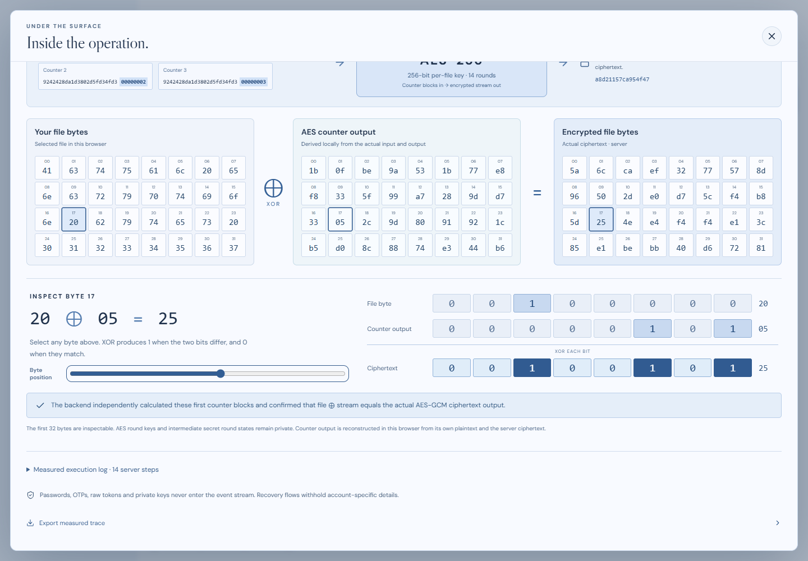

**Security model:** encryption is performed by the server using server-managed keys. The server receives plaintext uploads and can decrypt stored files. This is encryption at rest, not end-to-end encryption between independent users.

## 2. System architecture

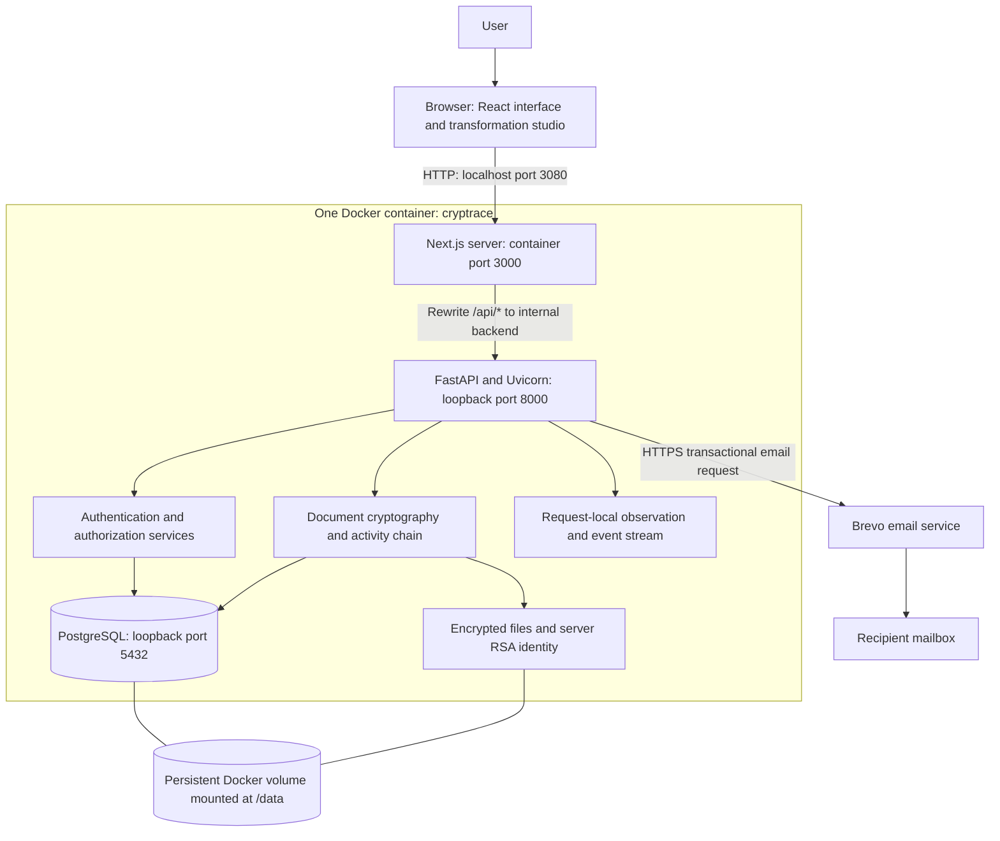

**HTTP** is Hypertext Transfer Protocol. **HTTPS** is Hypertext Transfer Protocol Secure. **API** is Application Programming Interface. **RSA** is named after Rivest, Shamir, and Adleman. Docker is the packaging and process environment, not an encryption algorithm.

The browser talks to a single origin, `http://localhost:3080`. Next.js forwards `/api/auth/login`, for example, to `http://127.0.0.1:8000/auth/login` inside the container. The backend and database do not have separately published host ports.

The single container still runs several real processes: the Next.js server, Uvicorn serving FastAPI, and PostgreSQL. One container does not mean one process or one program.

### Technology responsibilities

| Technology | Responsibility in this implementation |
| --- | --- |
| Next.js and React | Page rendering, account forms, workspace, document actions, browser state, and live visualization. |
| JavaScript and CSS | Interaction logic and visual styling. CSS means Cascading Style Sheets. |
| GSAP | GreenSock Animation Platform; animates interface transitions and byte tiles while respecting reduced-motion preferences. |
| FastAPI | Python request routing, validation, dependency resolution, background email tasks, and responses. |
| Uvicorn | Serves the Python application using ASGI, the Asynchronous Server Gateway Interface. |
| Pydantic | Validates request and response structures and configuration. |
| SQLAlchemy | ORM, or Object-Relational Mapping, between Python objects and PostgreSQL records. |
| PostgreSQL | Persistent account, session, credential, document metadata, and activity storage. |
| `cryptography` | Actual AES-GCM encryption and RSA encryption/signature operations. |
| Passlib and bcrypt | Salted password hashing and verification. |
| PyJWT | Encodes and validates signed JSON Web Tokens. |
| HTTPX | Makes real outbound email API calls. |
| SlowAPI | Applies configured request rate limits. |
| Playwright and axe-core | Browser journeys and automated accessibility checks. |
| Docker Compose | Builds and starts the single application container with persistent storage. |

There is no Three.js scene in the current implementation. Cryptographic mechanisms are represented using byte grids, bit rows, pipelines, verifier comparisons, and measured execution stages.

## 3. Source-code map

| File | Main responsibility |
| --- | --- |
| [`web/app/page.js`](web/app/page.js) | Authentication modes, workspace state, document actions, profile/activity loading, token refresh, and logout. |
| [`web/app/components/useLiveOperations.js`](web/app/components/useLiveOperations.js) | Associates requests with traces, consumes streamed events, reconciles recorded events, and keeps browser-local byte previews. |
| [`web/app/components/LiveOperations.js`](web/app/components/LiveOperations.js) | Live dialog, operation selection, measurements, execution log, and trace export. |
| [`web/app/components/TransformationView.js`](web/app/components/TransformationView.js) | Encryption, verifier, envelope, signature, and policy visualizations. |
| [`web/app/globals.css`](web/app/globals.css) | Shared visual system, responsive layouts, typography, byte inspection, and focus styling. |
| [`web/next.config.mjs`](web/next.config.mjs) | Backend rewrite, security headers, standalone build, and compression setting. |
| [`web/proxy.js`](web/proxy.js) | Early upload request-size rejection. |
| [`backend/app/api/auth.py`](backend/app/api/auth.py) | Authentication endpoints and scheduling security emails. |
| [`backend/app/services/auth.py`](backend/app/services/auth.py) | Registration, verification, password checks, email codes, session rotation, recovery, and reset logic. |
| [`backend/app/core/security.py`](backend/app/core/security.py) | Password hashing, JWT signing/decoding, refresh randomness, and protected comparison outputs. |
| [`backend/app/core/dependencies.py`](backend/app/core/dependencies.py) | Bearer-token and active-session authorization for protected routes. |
| [`backend/app/api/users.py`](backend/app/api/users.py) | Profile access and second-factor policy changes. |
| [`backend/app/api/vault.py`](backend/app/api/vault.py) | Document models, encryption, decryption, signatures, ownership checks, deletion, and activity authentication. |
| [`backend/app/core/observation.py`](backend/app/core/observation.py) | Trace capabilities, measured spans, event buffering, streaming, and replay. |
| [`backend/app/core/email.py`](backend/app/core/email.py) | Brevo requests and Cryptrace-branded email templates. |
| [`backend/app/models/user.py`](backend/app/models/user.py) | Account, session, one-time credential, and email-code database models. |
| [`backend/app/schemas/auth.py`](backend/app/schemas/auth.py) | Authentication input validation and public response structures. |
| [`backend/app/main.py`](backend/app/main.py) | App startup, table creation, middleware, errors, and background record cleanup. |
| [`deploy/start.sh`](deploy/start.sh), [`Dockerfile`](Dockerfile), [`compose.yaml`](compose.yaml) | Container build, persistent storage, process startup, and health checks. |

## 4. Database model and storage layout

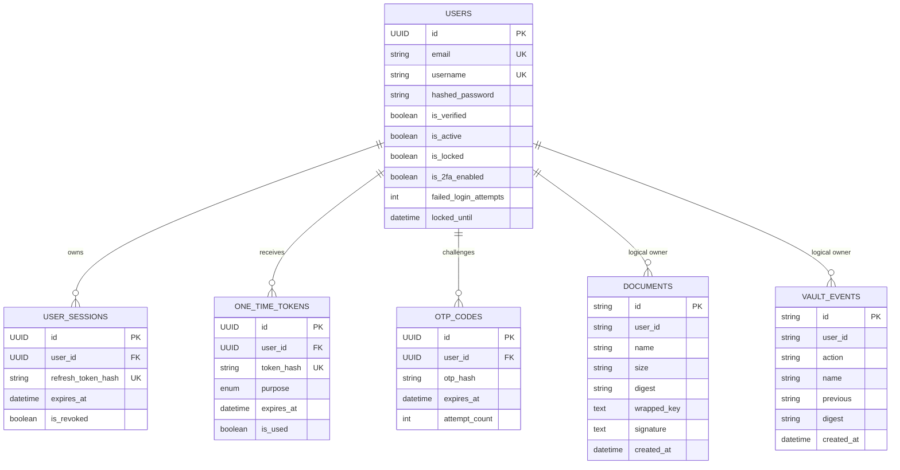

**UUID** means Universally Unique Identifier. **PK**, **FK**, and **UK** mean Primary Key, Foreign Key, and Unique Key. The document and activity owner links are enforced by application queries; those two models store `user_id` as a string without a declared database foreign-key constraint. Account-related credential models do declare foreign keys.

| Persistent location | Contents |
| --- | --- |
| `/data/postgres` | PostgreSQL database files. |
| `/data/vault/<document-id>` | Binary encrypted envelope for one document. |
| `/data/vault/identity.pem` | Persistent server RSA private key. |
| `/data/secret` | Persistent application secret used for JWT authentication and activity HMACs. |

Document names, sizes, ownership, timestamps, digests, wrapped keys, and signatures are database metadata. They are not all encrypted by the per-file content cipher. The file contents are encrypted before the application writes their envelope to disk.

## 5. Account registration and email verification

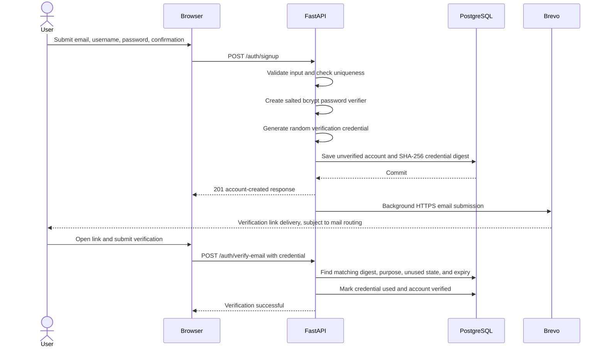

### Input rules

- Email is validated, lowercased, and trimmed.
- Username is 3–30 characters, accepts letters, digits, and underscores, and is stored lowercase.
- Signup and reset passwords must match their confirmation and include uppercase, lowercase, a digit, and a permitted special character.
- The password expression allows 8–128 characters, but an additional **72-byte maximum** applies for bcrypt. Consequently, the effective limit is stricter than the generic validation message suggests.
- Duplicate email or username registration returns a conflict response. Registration therefore does reveal those uniqueness conflicts; recovery endpoints use a different privacy policy.

### What is stored

```text
Password supplied by user
    └─ bcrypt with a random salt and work factor
         └─ stored password verifier, not the original password

Random verification credential: secrets.token_urlsafe(32)
    ├─ raw credential → email link
    └─ SHA-256 digest → one_time_tokens table
         purpose = email_verification
         expires after 24 hours
         is_used = false until accepted
```

**SHA-256** means Secure Hash Algorithm with a 256-bit output. The `32` above requests 32 bytes of random input before URL-safe encoding; it does not mean a 32-character final token.

Verification checks the digest, purpose, unused state, and expiry together. A valid credential is consumed in the database. Resending verification invalidates previous unused verification credentials before creating a replacement.

## 6. Login and password verification

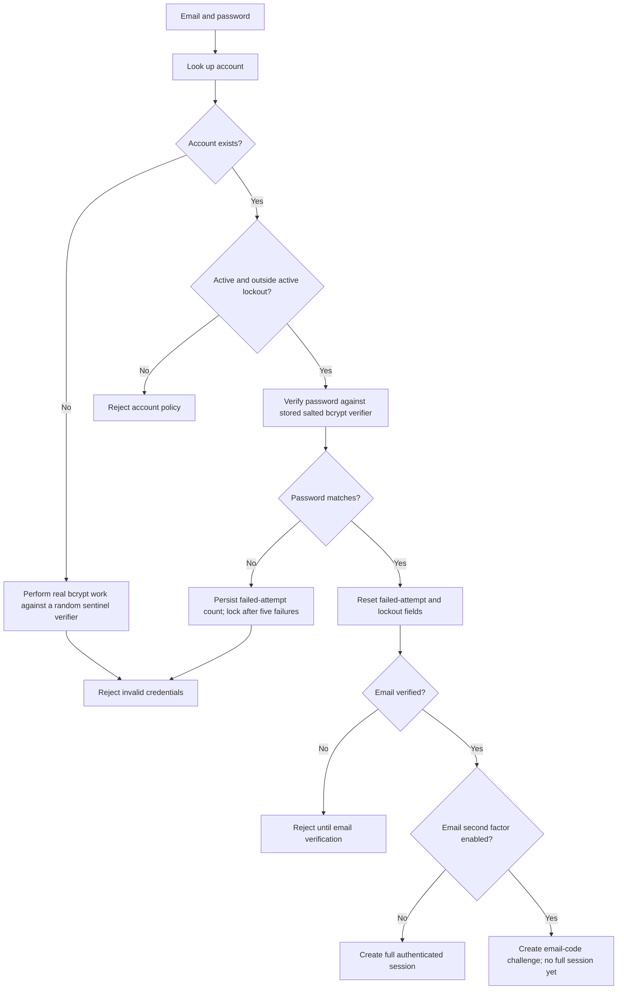

### bcrypt is password hashing, not password encryption

A bcrypt verifier contains the algorithm/version marker, cost, salt, and password-derived result. Checking a password repeats the relevant derivation using the stored verifier parameters. There is no password decryption step.

The current hashing setup uses a cost of 12, represented in the interface as a `2^12` work factor. This describes the algorithm's cost parameter; the application does not emit a live event for every internal bcrypt iteration.

`pwd_context.verify()` remains the authentication decision. For a traced verification, the code also derives a candidate with `bcrypt.hashpw()`, compares it with the stored verifier through `hmac.compare_digest()`, and checks that the two results agree. It stops with an error if the cross-check disagrees.

Five failed passwords lock an account for 30 minutes. A successful password login after the active lockout interval clears the counter and lock fields. The separate request limit is five login requests per minute per observed client address.

### What the login visualizer displays

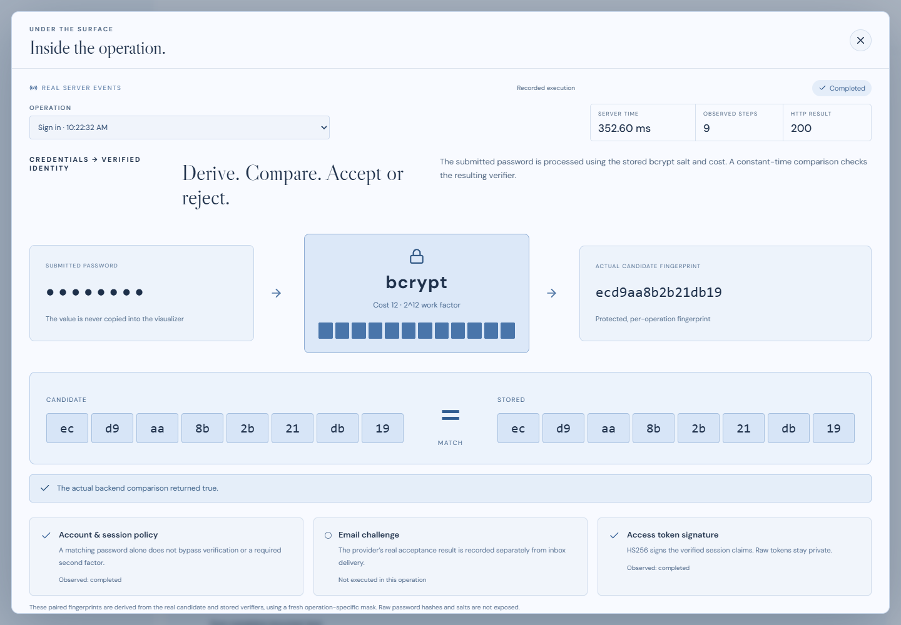

```text
Actual candidate verifier ── HMAC with fresh trace-only mask ── displayed fingerprint A
Actual stored verifier    ── HMAC with the same mask         ── displayed fingerprint B

Backend bcrypt result: true or false
Display: paired protected fingerprints and the real comparison verdict
```

**HMAC** means Hash-based Message Authentication Code. The display fingerprints are the first 16 hexadecimal characters of HMAC-SHA256 outputs, using a fresh random 32-byte mask for each trace. That mask never enters the public trace response.

The backend compares the actual verifier values, not these short display fingerprints. The fingerprints help visualize a result; they are not an authentication credential or a standalone collision-proof identity. Raw passwords, salts, and password verifier strings are excluded from the visualizer.

## 7. Email second-factor authentication

**2FA** means Two-Factor Authentication. **OTP** means One-Time Password; here it is a random six-digit email code. It is not an authenticator-app time-derived code and is not a hardware security key.

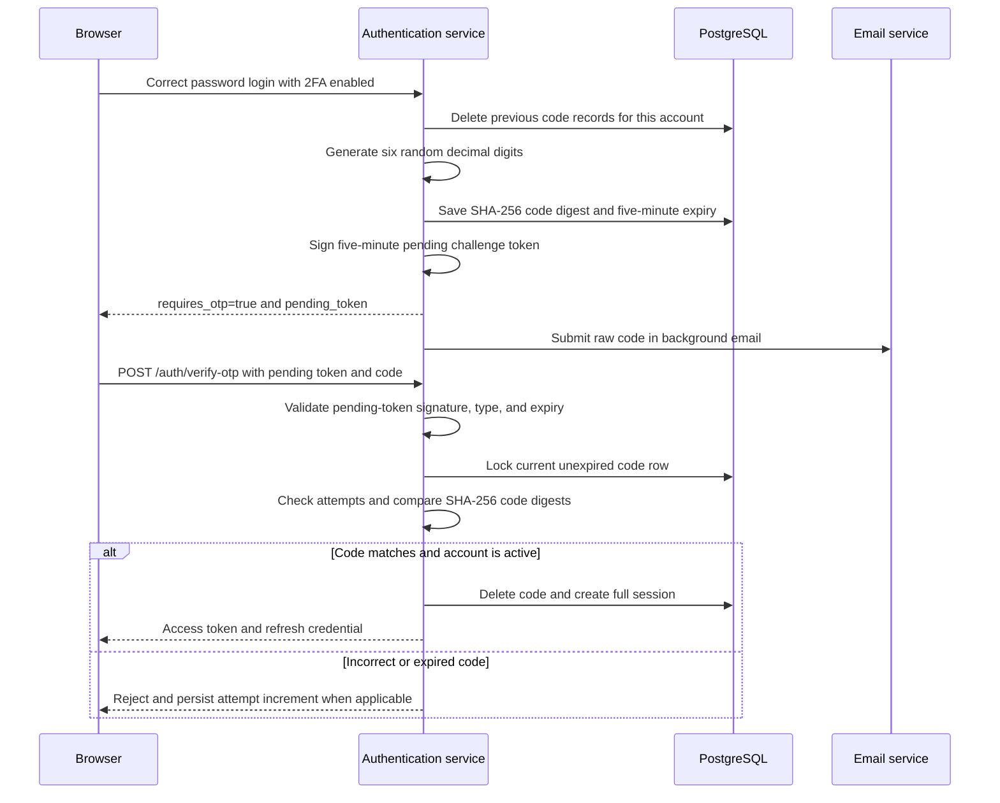

The pending token has type `2fa_pending`; protected routes require type `access`. Knowing a pending token alone does not authorize the vault.

The code is generated with `secrets.randbelow(1_000_000)` and formatted with leading zeros. The database stores only its SHA-256 digest. A wrong code increments its attempt count; after five failed comparisons, the next attempt encounters the attempt-limit gate and removes the challenge. A successful code is deleted immediately as part of session creation.

Because a six-digit code has a small possible value space, hashing alone does not make it strong against a stolen database. Its short lifetime, attempt limit, pending-token requirement, and request limits are essential parts of the design.

The second-factor enable/disable endpoints require an existing authenticated session. They currently change the policy without an additional password or code confirmation.

## 8. Access tokens, refresh rotation, and logout

**JWT** means JSON Web Token; **JSON** means JavaScript Object Notation. Cryptrace uses **HS256**, HMAC using SHA-256, to authenticate token contents. This is a symmetric message-authentication construction, distinct from the document RSA signature scheme.

### Access token structure

```text
Base64url(header) . Base64url(payload) . Base64url(authentication value)

Payload created by Cryptrace:
    sub   = account UUID
    sid   = session UUID
    exp   = expiration timestamp
    type  = "access"
```

A signed JWT is not encrypted. Its payload can be decoded by its holder. The authentication value detects unauthorized changes; it does not hide the claims. This distinction is defined in the [JSON Web Token specification](https://www.rfc-editor.org/rfc/rfc7519.html).

### Token and credential lifetimes

| Item | Default lifetime | Persisted representation |
| --- | --- | --- |
| Access JWT | 15 minutes | Raw value returned to browser; session identified by its `sid`. |
| Refresh credential/session | 7 days | SHA-256 refresh digest and session state in database. |
| Pending second-factor JWT | 5 minutes | Signed browser-held challenge handle. |
| Email OTP | 5 minutes | SHA-256 digest and attempt count. |
| Email-verification credential | 24 hours | SHA-256 digest, purpose, expiry, and used flag. |
| Password-reset credential | 1 hour | SHA-256 digest, purpose, expiry, and used flag. |

The access and refresh defaults are configuration fields. One-time credential lifetimes are service constants in the current code.

### Every protected request checks more than the JWT

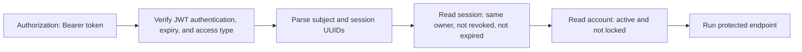

This database lookup makes revocation effective immediately on later protected requests. A valid-looking access token does not remain usable merely because its 15-minute expiry has not arrived.

### Rotation

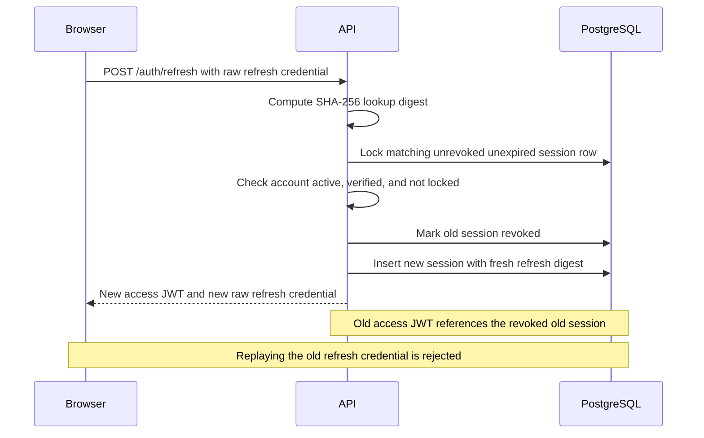

The refresh secret is generated from 64 random bytes before URL-safe encoding. Locking the old session row prevents two concurrent refresh requests from both successfully rotating that same row. The existing integration check verifies exactly one winner in that race.

Logout hashes the supplied refresh credential and marks its matching session revoked. It does not revoke every session for the account. Password reset does revoke every session.

### Browser storage

- Access token: React memory state.
- Refresh credential: browser `localStorage` under the retained internal key `vellum_rt`.
- Pending challenge: React memory state.
- Startup: attempt refresh, then load profile, documents, and activity in parallel.
- While signed in: attempt refresh every ten minutes.

The retained storage key is an internal compatibility name from before the Cryptrace rename. It is not a different platform. A page reload restores a session through the refresh credential rather than a persisted access token. Local storage is readable by JavaScript running in the same origin, which matters in the browser security boundary discussed later.

## 9. Password recovery and reset

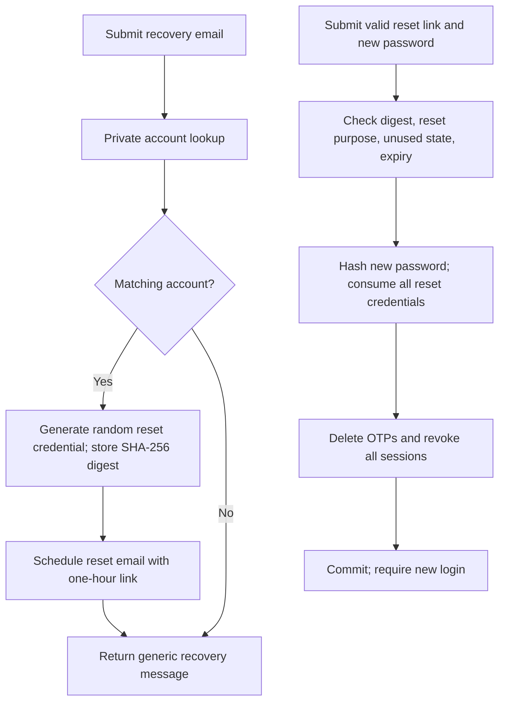

Recovery and resend-verification return generic messages to reduce account enumeration. Their traces suppress the account-specific lookup and conditional email details as well; otherwise the visualizer could undo the endpoint's privacy protection.

The recovery implementation can create more than one outstanding reset credential before any is used. Successfully resetting marks all password-reset records for that account used, clears code records, and revokes all its sessions. Link reuse is rejected.

## 10. Document upload and hybrid encryption

**Hybrid encryption** combines a fast symmetric content cipher with asymmetric protection of its small content key. Cryptrace uses **AES-256-GCM**, Advanced Encryption Standard with a 256-bit key in Galois/Counter Mode, and **RSA-3072-OAEP**, RSA with a 3072-bit modulus and Optimal Asymmetric Encryption Padding.

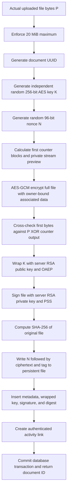

### Actual encryption parameters

| Parameter | Value and role |
| --- | --- |
| Maximum plaintext size | `20 × 1024 × 1024` bytes: 20 mebibytes, displayed as “20 MB” in the application. |
| Content key | New independent 32-byte secret for each file. |
| AES block size | 16 bytes, regardless of the 256-bit key size. |
| Nonce | 12 random bytes; public but must be used correctly with its key. |
| Associated data | UTF-8 encoding of `document_id + user_id`, with no separator in the actual code. |
| GCM tag | 16 bytes. |
| RSA modulus | 3072 bits; public exponent `65537`. |
| OAEP hash and mask | SHA-256 with MGF1 using SHA-256; no optional label. |
| Document signature | RSA-PSS with SHA-256, MGF1/SHA-256, and maximum supported salt length. |
| File fingerprint | SHA-256 of the entire plaintext file. |

**AAD** means Additional Authenticated Data. It is checked for authenticity without being encrypted. Supplying a different document/owner pair during decryption causes GCM authentication to fail.

**MGF1** means Mask Generation Function 1. **PSS** means Probabilistic Signature Scheme. **UTF-8** means Unicode Transformation Format, 8-bit. A **nonce** is a value intended for a single use in the relevant cryptographic context, not a password.

The file limit is checked in the browser, at the Next.js proxy for declared request length, in backend middleware for declared request length, and on the actual bytes read by the upload handler. Multipart request framing receives a small length allowance; the plaintext limit itself remains 20 MiB.

### Exact content-encryption call

```python
cipher_and_tag = AESGCM(key).encrypt(
    nonce,
    raw_file_bytes,
    (document_id + str(user.id)).encode(),
)
```

The authenticated-encryption library returns ciphertext followed by its tag. Cryptrace prepends the nonce when writing the file.

## 11. How the AES-GCM bytes are produced

### Counter blocks and the XOR operation

For the implementation's 96-bit nonce, the initial GCM block is `J0 = nonce || 00000001`. Content encryption starts from the next counter, `nonce || 00000002`; the following block ends in `00000003`.

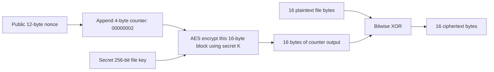

For a block or its final partial portion:

```text
Sᵢ = AES_K(counterᵢ)
Cᵢ = Pᵢ ⊕ Sᵢ
Pᵢ = Cᵢ ⊕ Sᵢ
```

`P` is plaintext, `C` is ciphertext, and `S` is counter output. XOR produces 1 when its input bits differ and 0 when they are equal.

**Illustrative arithmetic, not a stored secret or a claimed captured operation:**

```text
File byte        0x41     01000001
Counter output   0x1b     00011011
                         -------- XOR
Ciphertext       0x5a     01011010

Reverse: 0x5a XOR 0x1b = 0x41
```

### What is independently checked in this code

The upload handler computes at most the first two counter blocks using the actual file key and nonce. It encrypts those individual blocks through the low-level AES primitive and checks that:

```text
first up-to-32 plaintext bytes XOR calculated counter output
    == first up-to-32 bytes returned by the actual AES-GCM encryption
```

The comparison uses `hmac.compare_digest()`. A disagreement aborts the operation rather than showing an invented success. The main file cipher remains `AESGCM`; use of the ECB primitive here is only a way to encrypt the individual counter blocks for this cross-check, not ECB-mode file storage. **ECB** means Electronic Codebook.

### Inside AES itself

AES transforms 128-bit blocks. AES-256 has 14 rounds and a key schedule that derives round keys from its 256-bit key. Its named transformations are **SubBytes** (byte substitution), **ShiftRows** (row rotation), **MixColumns** (column mixing), and **AddRoundKey** (XOR with a round key). The final round omits MixColumns. The initial AddRoundKey precedes the numbered rounds. The [AES specification](https://nvlpubs.nist.gov/nistpubs/FIPS/NIST.FIPS.197-upd1.pdf) defines these transformations.

These transformations run inside the cryptography library. Cryptrace does not publish secret round keys, trace each substitution inside the library, or animate invented intermediate AES states. The “14 rounds” label identifies the real algorithm configuration, not fourteen separately observed callbacks.

### Authentication tag

GCM is **AEAD**, Authenticated Encryption with Associated Data. In addition to the counter-based encryption, its authentication calculation incorporates associated data, ciphertext, and their lengths. It uses a finite-field hashing operation called GHASH and a key-dependent mask to produce the tag. Cryptrace delegates that calculation and verification to `AESGCM` and records the actual returned tag; it does not separately instrument GHASH multiplications. The [GCM specification](https://nvlpubs.nist.gov/nistpubs/Legacy/SP/nistspecialpublication800-38d.pdf) defines the construction.

This tag distinguishes “bytes decrypted somehow” from “bytes authenticated successfully.” Wrong key material, a changed nonce, altered ciphertext/tag, or changed associated data can cause authentication to fail.

## 12. Key wrapping, signatures, and the stored envelope

### Key hierarchy

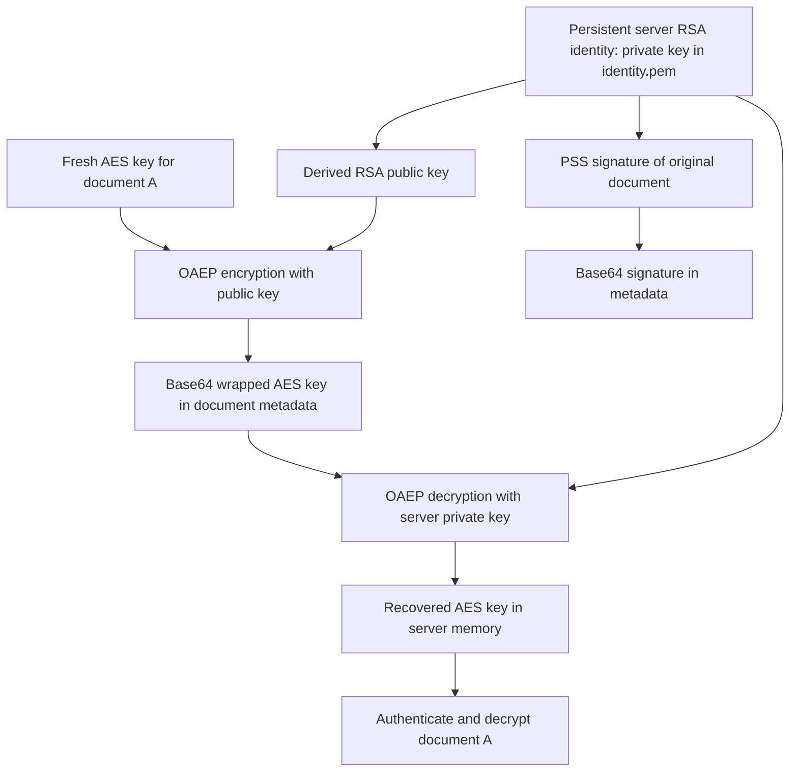

RSA encrypts the 32-byte AES key rather than the complete file. This keeps the large-file operation in the symmetric cipher and the asymmetric operation small. The wrapped key and the RSA signature are each 384 bytes for this 3072-bit RSA key before Base64 encoding.

OAEP encryption and PSS signing are different operations with different padding rules. Calling a signature “encrypting with the private key” would obscure the actual PSS encoding and verification performed here. Their definitions are covered by [RSA Cryptography Specifications](https://www.rfc-editor.org/rfc/rfc8017.html).

The same persistent RSA key pair currently serves both wrapping and signing roles. The signature proves consistency with this server's identity; it does not prove a particular end user personally signed a document with an independently controlled private key.

### Exact persistent envelope

```text
Encrypted file: /data/vault/<document UUID>

byte offset       0                  12                  12 + L          28 + L
                  ┌───────────────────┬────────────────────┬────────────────┐
                  │ nonce: 12 bytes   │ ciphertext: L bytes│ tag: 16 bytes  │
                  └───────────────────┴────────────────────┴────────────────┘

Total encrypted file size = original file size L + 28 bytes

Separate database row:
    name, owner, size, timestamp, SHA-256 digest,
    Base64 wrapped AES key, Base64 RSA-PSS signature
```

An empty file still has a 28-byte envelope, although it has no plaintext bytes to inspect. Base64 is a binary-to-text encoding, not encryption. A hexadecimal representation is also an encoding, not an additional security layer.

The private identity is saved as **PEM**, Privacy-Enhanced Mail encoding, containing **PKCS #8**, Public-Key Cryptography Standards number 8, private-key data. The file is not passphrase-encrypted; the implementation requests owner-only file permissions. Protection therefore depends on the container/volume access boundary as well as cryptography.

## 13. Download, verification, and deletion

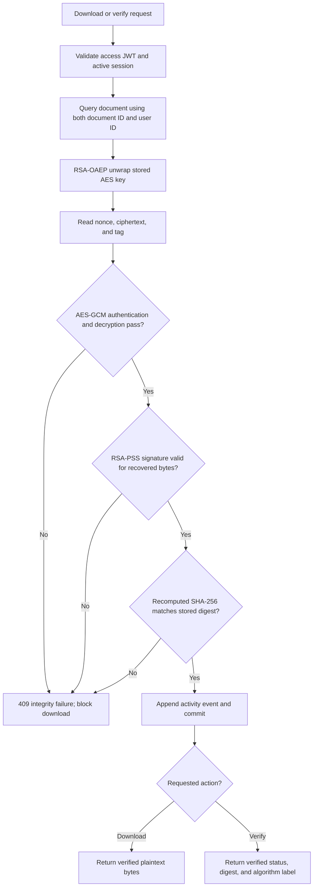

Ownership is checked before cryptographic recovery. A request for someone else's document receives “not found” because the query includes the authenticated owner, even if the requester knows a valid document identifier.

There are three distinct integrity checks:

| Check | What it checks |
| --- | --- |
| GCM tag | Ciphertext, associated data, and the corresponding nonce/key context. |
| RSA-PSS signature | Recovered plaintext against the stored signature under the server identity. |
| SHA-256 comparison | Recovered plaintext against the separately stored original content fingerprint. |

The digest is useful for content identification but is not itself a secret-key authentication mechanism. The implementation performs all three checks before releasing a download. Its generic integrity failure response also covers missing/unreadable envelopes or corrupted key/signature metadata encountered by `decrypt()`.

**Verify does decrypt internally.** It avoids returning plaintext to the caller; it does not perform a ciphertext-only proof.

**Delete** first appends a deletion activity record, deletes metadata, and commits. It then unlinks the encrypted file. Database and filesystem changes are not one shared atomic transaction. Likewise, upload writes the envelope before committing metadata. A failure between those steps can require orphan-file reconciliation. File unlinking is not a promise of forensic erasure of underlying storage blocks.

## 14. Authenticated activity history

Each account has a chain of events such as `Encrypted`, `Downloaded`, `Verified`, and `Deleted`. The first predecessor value is 64 hexadecimal zeros.

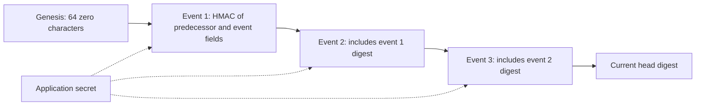

The exact authenticated message is the UTF-8 encoding of Python's `json.dumps(..., ensure_ascii=True)` for this array:

```text
[previous_digest, event_id, user_id, action, document_name]

event_digest = HMAC-SHA256(application_secret, encoded_array)
```

The event timestamp is stored for ordering but is not included in that authenticated array. Appending takes a database row lock on the user record to serialize this application's event writers for that account.

`GET /vault/audit/verify` reads the account's events in ascending timestamp order, recomputes the expected predecessor and HMAC at each step, and returns the count and final head if all links match. The Activity screen reads at most the 100 most recent records; chain verification reads the complete account chain.

This is a keyed, tamper-evident log, not a blockchain or an independently anchored append-only ledger. It detects changed fields and broken internal links. Without an externally trusted head/count, deleting a suffix of the history or the entire history cannot be reliably distinguished from a shorter valid history. A party possessing the application secret can recompute HMACs.

## 15. How the live visualization works

### From a click to measured events

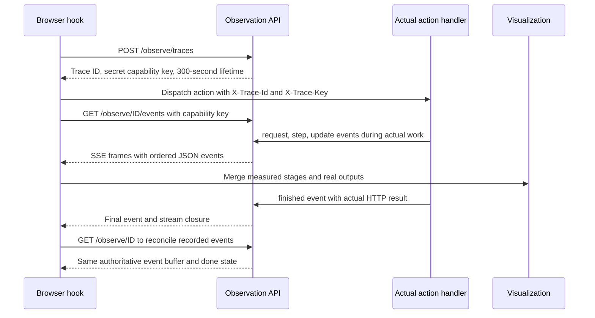

**SSE** means Server-Sent Events: a server-to-client stream over HTTP. The client uses streaming `fetch()` rather than the `EventSource` class so it can send its capability header. There is no WebSocket transport in this implementation.

The action is dispatched before the event stream is opened. The server buffers its events, so late subscription replays the beginning and then follows new work. This also prevents waiting event streams from reserving every browser connection ahead of the actions that would produce their events.

### What an observed stage is

`TraceMiddleware` binds a valid trace to exactly one action. Request-local context variables associate nested operations with that trace. The `step()` context manager emits a start, measures work with a monotonic performance clock, and emits a completion or rejection update. The `@observed` decorator wraps real function calls using that same mechanism.

| Event | Meaning |
| --- | --- |
| `request` | The bound request has started. |
| `step` | A named operation started, with an identifier and optional parent identifier. |
| `update` | Adds measured facts, timing, or completion/rejection for that stage. |
| `finished` | The request and awaited background work have ended; includes actual response status. |
| `expired` | The trace's stream lifetime ended. |

Typical event fields include `seq`, `at_ms`, stage `id`, `parent`, `category`, `explanation`, `status`, `facts`, and measured `duration_ms`. Sequence numbers order server events; animation duration does not replace the measured backend timing.

### Retention, permissions, and recovery

| Rule | Current implementation |
| --- | --- |
| Trace access | Possession of unpredictable trace ID and secret `X-Trace-Key` capability. |
| Binding | A trace can be attached to only one action request. |
| Access failure | Wrong/missing capability cannot retrieve its events; reused/invalid action binding is rejected. |
| Server lifetime | 300 seconds from trace creation. |
| Server capacity | At most 1024 trace rows and 160 recorded events per trace. |
| Cleanup | Expired rows are purged when a new trace is created; expiration also prevents later authorization. |
| Trace creation rate | 120 per minute per observed client address. |
| Browser history | Most recent 32 operations in component memory. |
| Streaming poll | Server checks for new buffered events at approximately 25-millisecond idle intervals. |
| Replay recovery | Client reconciles by sequence number against the protected snapshot; up to 20 checks, separated by 250 milliseconds when still incomplete. |
| Stream buffering controls | `no-store, no-transform`, `X-Accel-Buffering: no`, and Next.js compression disabled. |

No account login is required merely to create a trace: signup and login themselves need visualization. The capability is therefore the trace's read authorization, while the action separately retains its usual credential/ownership requirements.

Normal profile, document-index, and activity reads are recorded without automatically opening the dialog or taking selection away from an active action. A user can select those operations later. If trace setup fails before the action is sent, the normal action can proceed without telemetry. Once an action has been sent, the hook does not silently resend it on a later failure.

### Exactly where the visual data comes from

| Visible value | Origin |
| --- | --- |
| First up-to-32 upload plaintext bytes | Read from the user's selected file in browser memory. |
| Nonce and counter blocks | Actual upload generation, or actual stored envelope on recovery. |
| First up-to-32 ciphertext bytes | Actual AES-GCM result or stored encrypted file prefix. |
| Counter output displayed in the browser | Reconstructed locally from that plaintext and ciphertext using XOR. |
| `xor_verified` result | Independent backend counter-block calculation checked against actual AES-GCM output. |
| Download plaintext preview | First bytes read from the successful verified download response in that browser. |
| Wrapped-key and signature previews | Prefixes of actual cryptographic outputs. |
| Content digest and tag | Actual SHA-256 digest and GCM tag. |
| Candidate/stored login fingerprints | Actual verifier values transformed with a fresh trace-private HMAC mask. |
| Query counts | Actual returned list lengths. |
| Completion and rejection | Actual stage outcomes and response status, not elapsed animation guesses. |

The server never emits plaintext previews or raw counter keystream in the trace. Publishing both counter output and ciphertext would make the matching plaintext recoverable by anyone who held that trace. Instead the browser computes the display using its own file bytes or its authorized download.

The normal verify endpoint returns no recovered plaintext preview. A previous upload is not substituted as evidence of a later successful decryption.

## 16. Understanding the visualization screens

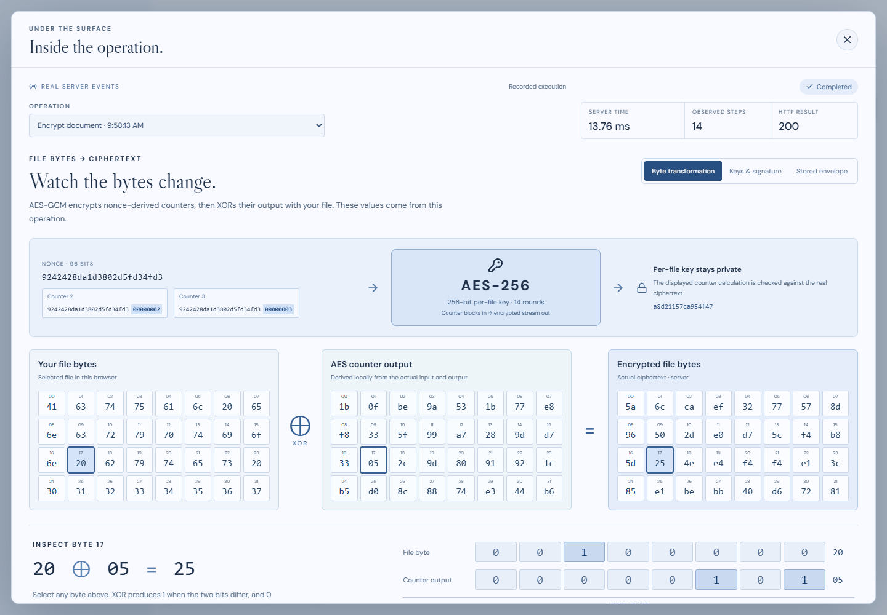

| View | How to read it |
| --- | --- |
| Byte transformation | Nonce and counter pipeline above three byte grids: file bytes, counter output, and ciphertext. |
| Selected-byte inspector | Click a byte or move the keyboard-accessible range control; inspect its hexadecimal value and eight individual bits. |
| Keys & signature | Shows AES key fingerprint, RSA wrapping output preview, signature preview, and actual cryptographic result. |
| Stored envelope | Shows nonce, ciphertext, tag, their byte lengths, and integrity-stage results. |
| Login comparison | Shows protected candidate/stored fingerprints and the real match/mismatch verdict. |
| Policy/state views | Show observed account/session transitions, returned record counts, recovery privacy, and deletion stages. |
| Measured execution log | Expand the actual nested stages, facts, durations, and rejected steps. |
| Export measured trace | Downloads JSON for the selected operation, explicitly excluding its browser-local plaintext preview. |

**Important scale distinction:** the whole file is encrypted and verified. The inspectable window is only its first 32 bytes. A key fingerprint is not the key, an output preview is not the full output, and a configured round count is not an instrumented round-by-round trace.

### Interface and accessibility

The interface uses local DM Sans and Libre Caslon Display font files, a restrained cool slate/blue palette, responsive layouts, native form controls, labelled actions, and keyboard focus handling. The live dialog supports Escape and focus trapping. Byte controls support keyboard navigation; the byte position also has a native range input. Motion respects `prefers-reduced-motion`.

GSAP animates presentation around actual state changes. It does not delay the server to make encryption look slow, generate fake intermediate secrets, or determine whether a request succeeded.

## 17. Email delivery and templates

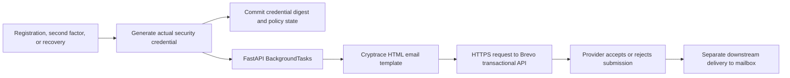

**HTML** means Hypertext Markup Language. Email templates use inline styles, table-based email layout, Cryptrace naming, cool colors, and clear verification/reset links or a six-digit code.

The backend submits JSON to `https://api.brevo.com/v3/smtp/email` using the configured API key. Although the endpoint path contains `smtp`, this application calls it over HTTPS; it does not open a direct **SMTP**, Simple Mail Transfer Protocol, connection.

Configuration requires `BREVO_API_KEY` and a verified `MAIL_FROM`. The container sets `MAIL_FROM_NAME=Cryptrace`; `APP_BASE_URL` determines the links. A provider timeout is set to 15 seconds. Missing configuration causes delivery to be skipped with a warning, and provider failures are caught and logged. The account/credential transaction is not rolled back merely because a later email send fails.

Background email tasks run after response delivery begins. Observation can continue until those tasks finish, so an action's visible timing may include email submission even though the browser already has an account-created or challenge response. The API success response does not guarantee inbox arrival. Mailbox receipt requires independent delivery evidence.

## 18. API reference

Paths below are backend paths. Browser requests prepend `/api`; for example `/auth/login` becomes `/api/auth/login`. Protected routes use `Authorization: Bearer <access-token>`.

| Method | Backend path | Authorization / input | Main result |
| --- | --- | --- | --- |
| POST | `/auth/signup` | Email, username, password, confirmation | Create unverified account; schedule verification email; 201. |
| POST | `/auth/verify-email` | Verification credential | Consume valid credential and verify account. |
| POST | `/auth/resend-verification` | Email | Generic response; eligible accounts receive replacement verification. |
| POST | `/auth/login` | Email and password | Token pair or pending email-code challenge. |
| POST | `/auth/verify-otp` | Pending token and six-digit OTP | Consume correct challenge and issue token pair. |
| POST | `/auth/refresh` | Raw refresh credential | Rotate into a new session and token pair. |
| POST | `/auth/logout` | Raw refresh credential | Revoke matching session. |
| POST | `/auth/forgot-password` | Email | Generic response; matching account receives reset link. |
| POST | `/auth/reset-password` | Reset credential, password, confirmation | Reset password and revoke all account sessions. |
| GET | `/users/me` | Access token | Allowed account profile fields. |
| POST | `/users/2fa/enable` | Access token | Enable email second-factor policy. |
| POST | `/users/2fa/disable` | Access token | Disable email second-factor policy. |
| GET | `/vault/documents` | Access token | Owned metadata, newest first. |
| POST | `/vault/documents` | Access token and multipart `file` | Encrypt and store; return document ID. |
| GET | `/vault/documents/{id}/download` | Access token and ownership | Verified recovered bytes. |
| POST | `/vault/documents/{id}/verify` | Access token and ownership | Integrity verdict, digest, and algorithm label. |
| DELETE | `/vault/documents/{id}` | Access token and ownership | Delete metadata and encrypted file. |
| GET | `/vault/activity` | Access token | Latest 100 owned activity records. |
| GET | `/vault/audit/verify` | Access token | Recompute full owned activity chain. |
| POST | `/observe/traces` | No account required | Fresh trace ID and secret capability. |
| GET | `/observe/{id}/events` | `X-Trace-Key` | Live/replayed event stream. |
| GET | `/observe/{id}` | `X-Trace-Key` | Authoritative buffered events and `done` state. |
| GET | `/openapi.json` | None | Machine-readable API schema; also used for health checks. |
| GET | `/docs` | None | Backend interactive API documentation route. |

The `/docs` handler is internal to FastAPI. The schema is reliably reachable through `/api/openapi.json`; the generated interactive page's schema URL is not separately adapted for the Next.js prefix.

### Status codes and request limits

| HTTP status | Typical meaning here |
| --- | --- |
| 200 / 201 | Operation succeeded / account created. |
| 400 | Invalid or expired one-time link; malformed request-size header. |
| 401 | Invalid login, OTP, access token, or refresh/session credential. |
| 403 | Account/policy restriction, such as locked or unverified account. |
| 404 | Document absent or not owned; missing/invalid trace capability. |
| 409 | Registration conflict, integrity failure, or invalid/reused trace binding. |
| 413 | Oversized document/request. |
| 422 | Request schema validation failure. |
| 429 | Request rate/attempt limit or trace capacity exceeded. |
| 500 | Unexpected server failure; generic public error message. |

| Explicit rate limit | Value |
| --- | --- |
| Login | 5 per minute. |
| OTP verification | 10 per minute. |
| Forgot password | 5 per hour. |
| Resend verification | 3 per hour. |
| Trace creation | 120 per minute, on its observation limiter. |

These limits use the backend's observed client address, which can be a proxy address. They should not be described as guaranteed unique-human or unique-device limits. Other endpoints do not automatically inherit these exact limits.

## 19. Docker and startup

From the repository root:

```powershell
docker compose up --build -d --wait
```

Open **http://localhost:3080**. The application container is named **`cryptrace`**.

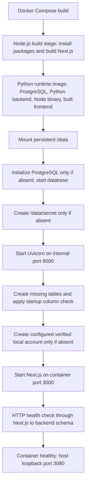

The multi-stage image builds the frontend with Node.js 22 and uses a Python 3.11 Debian-based runtime containing PostgreSQL 15. The Next.js standalone build is copied into the final image; it is not served by a separate frontend container.

The Compose volume's retained logical name is `vellum-data`, normally materialized as `auth-system-viz_vellum-data` for this checkout. The internal database is also still named `vellum`. These internal names preserve existing stored accounts, keys, and documents after the public rename; the running application/container brand is Cryptrace.

### Configuration without exposing secrets

| Setting | Purpose |
| --- | --- |
| `BREVO_API_KEY` | Secret transactional email service credential. |
| `MAIL_FROM` | Verified sender email address. |
| `MAIL_FROM_NAME` | Sender display name; set to Cryptrace by this container. |
| `DEMO_EMAIL` | Optional local seeded-account address. |
| `APP_BASE_URL` | Public root for verification/reset links; Compose sets localhost:3080. |
| `ALLOWED_ORIGINS` | CORS allowlist; Compose sets localhost:3080. |
| `SECRET_KEY` | Runtime application secret loaded from persistent `/data/secret`. |
| `DATABASE_URL` | Runtime internal PostgreSQL connection string set by startup. |
| `REDIS_URL` | Optional authentication limiter backend; empty means in-memory storage. No Redis container is started by this Compose file. |
| `VAULT_PATH` | Optional alternative vault path; default `/data/vault`. |

`.env` is ignored by Git and excluded from Docker's build context. Do not place an API key in this guide or source files. Compose supplies environment configuration when starting the container.

The seed script selects `DEMO_EMAIL`, otherwise `MAIL_FROM`, otherwise `demo@cryptrace.app`. It creates a verified account only when that email is absent. Its existing local demonstration password is documented in the short README; it is a seed convenience, not a password assigned to every registered user.

### Lifecycle and persistence

```powershell
docker compose ps
docker compose logs --tail 100
docker compose restart
docker compose down
```

Normal restart/recreation and `docker compose down` retain the named volume. Removing that volume would remove the database, server keys, and stored files together. A useful backup must preserve all those components consistently, not only the document table.

The startup script creates `/data/secret` from 48 cryptographically random bytes encoded as hexadecimal and preserves it on later starts. The RSA identity is likewise generated only when absent. Changing or losing those secrets affects JWT/HMAC validation and/or recovery of stored document keys.

PostgreSQL binds to loopback inside this container and is initialized with local trust authentication. The public host binding is also loopback-only. This is the current local deployment configuration, not a separately hardened public database service.

## 20. Security boundaries and current limits

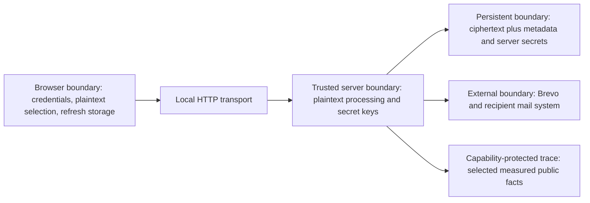

| Property / threat | Actual protection | Scope or limitation |
| --- | --- | --- |
| Confidentiality at rest | Per-document AES-256-GCM encryption and RSA-wrapped keys. | Server administrators/processes with the private key can decrypt. Metadata remains readable in the database. |
| Document tampering | GCM authentication, RSA-PSS verification, and SHA-256 comparison. | Depends on preserving trusted server key material; not an independent user signature system. |
| Unauthorized object access | Access-token/session checks plus owner-scoped queries. | Authorization is enforced on the server, not by hiding buttons. |
| Password database exposure | Salted bcrypt verifiers with work factor. | Weak user passwords can still be guessed offline; no reversible password encryption is used. |
| Online guessing | Rate limits, five-failure account lock, OTP attempts/expiry. | In-memory limiter state resets on restart; lock counters persist in PostgreSQL. |
| Refresh replay | Session-row locking and rotation/revocation. | A stolen still-unused refresh secret remains a bearer credential until rejected/revoked/expired. |
| Logout/reset | Later protected requests consult revocation state. | Logout is per matching session; reset revokes all account sessions. |
| Account enumeration | Generic recovery/resend responses and private recovery traces. | Registration conflicts and certain login policy errors are explicit. |
| Trace leakage | Unpredictable capability, short authorization lifetime, safe output selection, no raw secrets. | Anyone holding a valid capability can read its selected event facts; exported traces may include public cryptographic previews and timestamps. |
| Browser script injection | React escapes normal text rendering; local assets and security headers reduce some exposure. | A successful XSS attack could access local-storage refresh credentials. XSS means Cross-Site Scripting. |
| Browser request isolation | Same-origin Next.js rewrite and configured CORS policy. | CORS is not authentication. Broad claims of complete CSRF protection are not established here. |
| Transport interception | Loopback-only local access. | Local app traffic is HTTP; no TLS certificate/termination is configured in this container. |
| Activity tampering | Linked HMACs over selected event fields. | No external anchor, timestamp authentication, or suffix-truncation guarantee. |
| Availability | Size limits, bounded trace storage, health check, restart policy. | One container is one failure boundary; file operations are memory-based and have no resumable streaming protocol. |
| Database/filesystem consistency | Database transactions plus ordered file writes/deletes. | The database and filesystem are not one atomic unit. |

**CORS** means Cross-Origin Resource Sharing. **CSRF** means Cross-Site Request Forgery. **TLS** means Transport Layer Security. The Next.js responses set `X-Content-Type-Options: nosniff`, `X-Frame-Options: DENY`, a `no-referrer` policy, and restrictions on camera, microphone, and geolocation access.

The code currently has no configured Content Security Policy, independent public-key certificate distribution, hardware key storage, server-key rotation workflow, malware scanning, or external audit anchor. These are implementation boundaries, not features to imply from the use of strong cryptographic algorithms.

The authentication limiter can use Redis when configured. The observation buffer and its limiter remain process-local. The single-worker process arrangement fits the current telemetry design; simply adding backend workers would not create a shared trace store.

The hourly cleanup task deletes expired email-code records and one-time token records that are both expired and used. It is not a comprehensive cleanup of expired sessions or every unused expired credential.

## 21. Verification evidence and how to run checks

The repository contains executable checks and captured evidence. Counts below describe the recorded runs; they do not assert that every possible attack or deployment condition has been proved safe.

| Check group | Recorded coverage | Evidence |
| --- | --- | --- |
| Backend functional/security integration | 52 passing checks: real encryption, exact downloads, ownership, ciphertext/signature/digest/key tampering, code replay, reset/logout revocation, lockout, and concurrent refresh. | [`checks/integration.py`](checks/integration.py), [`evidence/final-transformation-checks.txt`](evidence/final-transformation-checks.txt). |
| Observation and transformation verification | 51 passing checks: events before login response completion, exact replay/capability checks, real timings, actual nonce/tag/ciphertext matching, XOR cross-check, and secret exclusion. | [`checks/observation.py`](checks/observation.py), same captured report. |
| Browser journeys | Two journeys: account/vault workflow and actual verifier/byte visualization; latest post-rename run passed both. | [`web/journey.spec.js`](web/journey.spec.js), [`web/live.spec.js`](web/live.spec.js), [`evidence/browser-results.json`](evidence/browser-results.json). |
| Accessibility scans | Captured login/transformation scans report no violations for their selected rule tags. | [`evidence/transformation-accessibility.json`](evidence/transformation-accessibility.json), [`evidence/byte-transformation-accessibility.json`](evidence/byte-transformation-accessibility.json). |
| Additional checks | Restart persistence, email submission, oversized upload, and malformed-token stress scripts. These are separate from the 103 backend/observation checks. | [`checks/persistence.py`](checks/persistence.py), [`checks/email_delivery.py`](checks/email_delivery.py), [`checks/stress.py`](checks/stress.py). |

The browser visualization journey deliberately aborts one event stream, then verifies recovery from the server's protected recorded events. It also checks a selected byte's XOR equation, compares it with exported actual ciphertext, confirms local plaintext is absent from export, and checks mobile overflow.

From the repository root, with Docker running:

```powershell
# Build/start the actual application.
docker compose up --build -d --wait

# Install browser-test dependencies on the host, when not already installed.
Push-Location web
npm ci
npx playwright install chromium
Pop-Location

# Run existing backend, observation, and browser checks.
.\checks\run.ps1
```

The check runner copies the Python checks into `cryptrace`, runs them there, restarts the container to reset the transient request-limit window, waits for health, and then runs the browser tests. The browser tests use the configured local account, so that account's expected seed password/state must match the existing test setup. Repeated wrong-password experimentation can legitimately trigger lockout.

Accessibility scans cover the rendered states and rules examined; they are not a certification of every interaction. Likewise, successful stress checks are evidence for their request counts and conditions, not an unbounded availability guarantee.

## 22. Walkthrough of a complete document lifecycle

1. **Create and verify an account.** Observe salted password hashing, database commit, and the actual email submission stage. Open the verification link and consume its credential.
2. **Sign in.** Inspect the bcrypt comparison. A wrong password produces a real rejected comparison; correct credentials continue into policy checks and session creation.
3. **Optionally enable the email second factor.** Sign out, sign in again, receive the actual email code, and complete the challenge before accessing the workspace.
4. **Upload a small text or binary file.** Open Byte transformation. Note the real nonce, counter blocks, plaintext prefix, and ciphertext prefix.
5. **Select a byte.** Check that the eight XOR positions and hexadecimal equation agree. Open Keys & signature and Stored envelope to follow the additional mechanisms.
6. **Export the measured trace.** Inspect the actual stage facts and timings. The local plaintext prefix is deliberately excluded.
7. **Verify the stored document.** The backend unwraps, decrypts, authenticates, checks the signature, and compares its digest; it returns an integrity result.
8. **Download it.** The same checks precede the recovered bytes. Compare the downloaded file with the original; the browser journey performs an actual byte equality check.
9. **Check Activity.** Verify the keyed event chain and inspect its actual record count.
10. **Restart the container if checking persistence.** Database, server identity, application secret, and envelopes are retained on the mounted volume.
11. **Delete the document and sign out.** Metadata removal, encrypted-file unlinking, and session revocation are distinct backend operations.

## 23. Cryptographic concept map

| Concept | Where it appears |
| --- | --- |
| Authentication | Password verifier, optional email code, signed access token, and active-session checks. |
| Authorization | Authenticated owner-scoped document queries. |
| Confidentiality | AES encryption of file contents. |
| Integrity | GCM tag, RSA-PSS signature verification, SHA-256 comparison, and HMAC activity links. |
| Symmetric cryptography | AES file key; HMAC application-secret authentication. |
| Asymmetric cryptography | RSA public/private identity for wrapping and signatures. |
| Hash functions | File fingerprints and lookup digests for random credentials/codes. |
| Key distribution inside the system | RSA-wrapped file keys stored with metadata; server private key unwraps them. |
| Replay resistance | Consumed one-time credentials/codes and revoked refresh sessions. |
| Block-cipher mode | GCM's counter encryption plus authentication; no block padding of the plaintext file is needed. |
| Remote user authentication | Browser/password/code/token interaction with the backend. |
| Transport security | Brevo uses HTTPS; local app currently uses HTTP. |

The project does not implement every algorithm related to these subjects. DES, RC4, Diffie–Hellman exchange, ElGamal signatures, Schnorr signatures, SSL, and SSH are not application features in this repository. Their full forms or naming notes are included below so the concepts are not confused with the implemented mechanisms.

## 24. Full forms and terminology

### Cryptography and security

| Term | Full form or precise naming note |
| --- | --- |
| AES | Advanced Encryption Standard. |
| AES-256 | AES using a 256-bit key; its block size is still 128 bits. |
| GCM | Galois/Counter Mode. |
| AEAD | Authenticated Encryption with Associated Data. |
| AAD | Additional Authenticated Data. |
| RSA | Rivest–Shamir–Adleman, named after its inventors. |
| OAEP | Optimal Asymmetric Encryption Padding. |
| PSS | Probabilistic Signature Scheme. |
| MGF1 | Mask Generation Function 1. |
| SHA | Secure Hash Algorithm. |
| SHA-256 | SHA with a 256-bit digest. |
| MAC | Message Authentication Code. |
| HMAC | Hash-based Message Authentication Code. |
| HS256 | HMAC using SHA-256, the JWT algorithm identifier used here. |
| XOR | Exclusive OR; the bitwise operation written `⊕`. |
| ECB | Electronic Codebook; used only for individual counter-block cross-check calculations here. |
| CTR | Counter mode; a related block-cipher mode concept underlying the counter-encryption explanation. |
| IV | Initialization Vector; the nonce is the GCM initialization input here. |
| CSPRNG | Cryptographically Secure Pseudorandom Number Generator. Python's `secrets` and operating-system randomness provide the randomness used here. |
| OTP | One-Time Password; the application's random six-digit email code. |
| 2FA | Two-Factor Authentication. |
| MFA | Multi-Factor Authentication; broader term for requiring multiple authentication factors. |
| JWT | JSON Web Token. |
| JWS | JSON Web Signature; the signed/MAC-protected token structure relevant to the JWT explanation. |
| PKCS | Public-Key Cryptography Standards. PKCS #8 specifies private-key information formatting. |
| PEM | Privacy-Enhanced Mail; commonly used name for the text-armored key encoding format. |
| XSS | Cross-Site Scripting. |
| CSRF | Cross-Site Request Forgery. |
| IDOR | Insecure Direct Object Reference; an object-authorization failure that owner-scoped queries aim to prevent. |
| MITM | Man-in-the-Middle; interception between communicating parties. |
| DES | Data Encryption Standard; not used by Cryptrace. |
| RC4 | Rivest Cipher 4, also historically called Ron's Code 4; not used here. |
| DH | Diffie–Hellman, named after Whitfield Diffie and Martin Hellman; not implemented as an app key-exchange feature. |
| ElGamal / Schnorr | Algorithm names taken from their creators; not acronyms and not implemented here. |
| bcrypt | Algorithm name, not a standard acronym with a full-form expansion. It is a salted adaptive password-hashing scheme. |
| GHASH | Name of GCM's finite-field hash function; not an acronym to expand into an invented phrase. |
| Nonce | A value intended for one use in its cryptographic context, conventionally described as “number used once.” |
| Salt | Non-secret per-hash input that makes identical passwords produce different password verifiers. |
| Plaintext / ciphertext | Original bytes / encrypted bytes. |
| Fingerprint / digest | Compact hash-derived representation; a fingerprint does not reveal the complete key it represents. |
| Base64 / Base64url | Binary-to-text encodings, with a URL-safe alphabet for the latter; neither is encryption. |

### Web, runtime, data, and documentation

| Term | Full form or precise naming note |
| --- | --- |
| API | Application Programming Interface. |
| HTTP | Hypertext Transfer Protocol. |
| HTTPS | Hypertext Transfer Protocol Secure. |
| TLS | Transport Layer Security. |
| SSL | Secure Sockets Layer; an older protocol family, not the local app's configured transport. |
| SSH | Secure Shell; not an application feature here. |
| SMTP | Simple Mail Transfer Protocol. |
| SSE | Server-Sent Events. |
| ASGI | Asynchronous Server Gateway Interface. |
| CORS | Cross-Origin Resource Sharing. |
| HTML | Hypertext Markup Language. |
| CSS | Cascading Style Sheets. |
| JS | JavaScript; JavaScript itself is a language name, not an acronym. |
| JSON | JavaScript Object Notation. |
| DOM | Document Object Model. |
| URL | Uniform Resource Locator. |
| UTF-8 | Unicode Transformation Format, 8-bit. |
| SQL | Structured Query Language. |
| ORM | Object-Relational Mapping. |
| UUID | Universally Unique Identifier. |
| ID | Identifier. |
| SID / `sid` | Session identifier claim in this application. |
| `sub` / `exp` | Subject / expiration-time JWT claims. |
| DB | Database. |
| PK / FK / UK | Primary Key / Foreign Key / Unique Key. |
| TTL | Time To Live. Trace authorization lifetime is 300 seconds. |
| EOF | End Of File; also used for the end of a response stream. |
| UI / UX | User Interface / User Experience. |
| GSAP | GreenSock Animation Platform. |
| CLI | Command-Line Interface. |
| npm | Name of the Node.js package-management tool; commonly called Node Package Manager, rather than a cryptographic/runtime standard. |
| MD | Markdown, the text-document format of this guide. |
| YAML | YAML Ain't Markup Language, the recursive name of the Compose configuration format. |
| MB / MiB | Megabyte, normally 1,000,000 bytes / mebibyte, exactly 1,048,576 bytes. The app's displayed 20 MB limit is implemented as 20 MiB. |
| KB / B | Kilobyte / byte; UI size formatting uses powers of 1024. |
| ms / UTC | Millisecond / Coordinated Universal Time. |
| WCAG | Web Content Accessibility Guidelines. |
| RFC | Request for Comments, an Internet technical publication series. |
| NIST | National Institute of Standards and Technology. |
| FIPS | Federal Information Processing Standards. |
| SP | Special Publication, in the NIST document series. |
| React / Next.js / FastAPI / PostgreSQL / Docker / Brevo | Product or project names; do not invent acronym expansions for them. The API and SQL portions have the definitions above. |
| Mermaid | Text-based diagram notation used in this document; not an encryption mechanism. |

## 25. References and accuracy notes

The implementation source linked throughout this guide is the authority for what Cryptrace currently does. The following primary references explain the underlying algorithms and token format; they do not claim this deployment has received independent certification:

- [NIST FIPS 197 — Advanced Encryption Standard](https://nvlpubs.nist.gov/nistpubs/FIPS/NIST.FIPS.197-upd1.pdf).
- [NIST SP 800-38D — Galois/Counter Mode](https://nvlpubs.nist.gov/nistpubs/Legacy/SP/nistspecialpublication800-38d.pdf).
- [RFC 8017 — RSA Cryptography Specifications](https://www.rfc-editor.org/rfc/rfc8017.html).
- [RFC 7519 — JSON Web Token](https://www.rfc-editor.org/rfc/rfc7519.html).

Screenshots show a captured completed execution. Fresh uploads produce new keys, nonces, ciphertext, wrapping outputs, and signatures, so their displayed values should differ. The live view remains tied to real requests; the diagrams in this guide explain their mechanisms and sequence rather than pretending to be live measurements.
